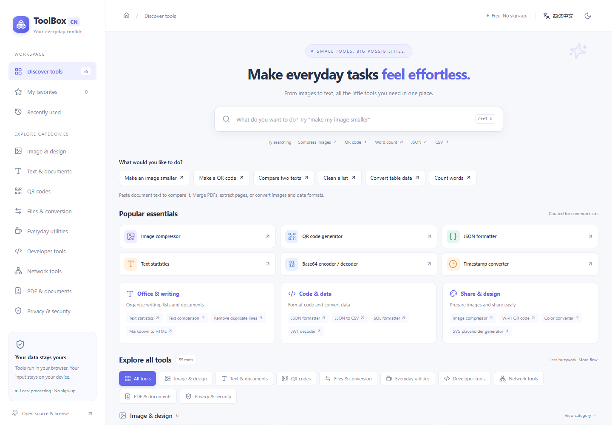
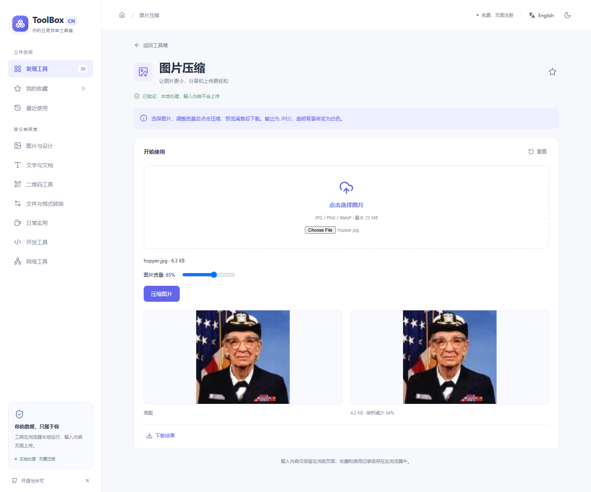

# ToolBox CN

[Open ToolBox CN](https://cfl071023-bit.github.io/toolbox-cn/) · [Source](https://github.com/cfl071023-bit/toolbox-cn) · [Build & deployment](https://github.com/cfl071023-bit/toolbox-cn/actions)

**Make everyday tasks feel effortless.** A free, Chinese-first toolbox with 55 working tools, no account requirement, English switching, and browser-based processing.

[简体中文](README.zh-CN.md) · [Deployment](docs/DEPLOYMENT.md) · [Contributing](CONTRIBUTING.md) · [License](LICENSE) · [Corresponding source](SOURCE-CODE.md)



## Start with the task you want to finish

Make a photo smaller, share a link as a QR code, or clean a duplicate list. Choose a task on the homepage or describe it in search, enter your content, then copy or download the result.

- Task-oriented bilingual discovery, without requiring technical tool names. Unsupported PDF/Word file conversion is stated explicitly.
- Examples, task-specific actions, useful recovery guidance, completion feedback and honest empty results.
- Share the tool URL without your input or query parameters. Privacy details distinguish loading code from processing data locally.

The current working tree is **0.3.0-dev**. Source is published as cfl071023-bit/toolbox-cn. GitHub Actions builds and deploys the site to GitHub Pages; see the Actions link for initial deployment status. Historical QA is retained; frozen release ZIPs remain in the original maintainer workspace rather than being duplicated in this source repository.


This expansion retains the original 30 tools and adds 25. PDF compression, OCR and image tracing are **not included or counted**. See [selection/provenance](docs/UPSTREAM-EXPANSION.md) and [current verification report](docs/PLATFORM-EXPANSION-QA.zh-CN.md). Historical 0.1.0 release documents describe that frozen version, not this development tree.

## Features

| Category | Tools |
| --- | --- |
| Image & design | Compression, crop, resize, JPG/PNG/WebP conversion, color conversion, SVG placeholders |
| PDF & documents | PDF merge and page extraction |
| Text & writing | Text comparison, word statistics, case conversion, duplicate-line cleanup, Markdown to HTML, Markdown preview/tables, list comparison, HTML text extraction/entities |
| QR & sharing | Text/link and Wi-Fi QR generation; read QR images |
| Everyday utilities | Timestamps, temperature, Roman numerals, percentages, units, calendar-day difference |
| Data & conversion | Base64 text/files, URL encoding, JSON↔YAML/CSV/XML/TOML, JSON flatten/nest |
| Developer tools | JSON/XML/SQL formatting, JSON tree/diff, regex, CSS/JS formatting/minification, UUID, text SHA-256, random strings, number bases |
| Network tools | URL parsing, IPv4 subnet calculation, JWT decoding |
| Privacy & security | File SHA-256 checksum (not a malware scan) |

Includes curated common tools, task recommendations, categories, bilingual search and Chinese aliases, favorites, recent tools, dark/light themes and mobile layouts. Popular tools are editorial selections, with no invented usage metrics. Every card opens a working tool.

<p></p>

## Install and develop

Requires Node.js 24 (recommended) or Node.js 22.x >=22.12, and npm 10+. Release checks use Node.js 24. Extract the source archive and run these commands in the directory containing package.json:

```sh
npm ci
npm run dev
```

Open [the local development server](http://127.0.0.1:5178/). No environment variables, API keys, database or account are required. No public repository or hosted demo has been published yet, so there is no clone or live-demo URL to advertise.

```text
src/             UI, catalog, engines and retained upstream utilities
public/          Static assets, licenses and generated corresponding source
scripts/         Source packaging, browser smoke checks and release archives
tests/           Engine/browser tests and real image fixtures
docs/            Deployment, license review, screenshots and engineering notes
qa-evidence/     QA records; distributed copies redact machine-specific paths
upstream/        Original pinned CorentinTh source and notices
upstream-sharevb/ Pinned sharevb expansion source and notices
```

## Tests and production build

```sh
npm test
npx playwright install chromium
npm run test:e2e
npm run build
npm run test:smoke
```

Deploy the complete dist/ directory, including source.zip and legal notices. The prebuild step regenerates corresponding source and dependency notices. The smoke test starts and stops a temporary local production server. For manual inspection, run `npm run preview` and open [the production preview](http://127.0.0.1:5179/). Do not open index.html with file://.

The first functional QA round executed 58 unit tests and 77 browser checks each against development and production. See [the QA report](FUNCTIONAL-QA.zh-CN.md). Current expansion results and limits are in the [expansion QA report](docs/PLATFORM-EXPANSION-QA.zh-CN.md); [0.1.0 release status](docs/RELEASE-STATUS.zh-CN.md) remains a historical frozen record. Physical phones, Safari/Firefox and an independent security audit are not covered by those results.

## Privacy and limits

The current 55 engines were checked with actual processing offline after their assets loaded. Tests found no input uploads or persistent input/output storage. Only favorite/recent tool IDs, theme and language are stored locally. There are no analytics scripts, remote fonts or upload endpoints. Initial visits and lazy-loaded code still require network access; the hosting provider receives ordinary asset requests. External links open only when clicked.

Image compression exports JPEG with a white background and may produce a larger file. JWT decoding does not verify signatures. Networking tools do not probe remote services. Quote large integers in JSON/YAML/CSV conversions when exact precision matters; JSON formatting itself preserves number tokens. SHA-256 is not a password-storage scheme. Wi-Fi QR recipients can read the password. Markdown output is source code and must be sanitized before embedding elsewhere. Clipboard and Web Crypto require HTTPS or localhost.

## License, attribution and contribution

Distributed as a **GPL-3.0-only** derivative, retaining upstream and third-party notices. Based on [CorentinTh/it-tools](https://github.com/CorentinTh/it-tools), exact commit [`d505845f918e946ec300af7b36efc107e2f66e9e`](https://github.com/CorentinTh/it-tools/tree/d505845f918e946ec300af7b36efc107e2f66e9e). Its package version field is `2024.10.22-7ca5933`; that label is not the pinned commit ID.

IT-Tools © Corentin Thomasset and contributors. ToolBox CN modifications © 2026 ToolBox CN contributors. No warranty. Retain [LICENSE](LICENSE), [NOTICE.md](NOTICE.md), [REUSE.md](REUSE.md) and third-party notices. A hosted release must keep matching complete source accessible through the existing Open source & license dialog; minified JavaScript alone is insufficient.

Please read [CONTRIBUTING.md](CONTRIBUTING.md). Focus on verified bugs, clear wording and accessibility, preserve the visual identity, and run relevant checks. A public repository has not yet been created; use its issue/PR process only after publication.

Expansion source: [sharevb/it-tools](https://github.com/sharevb/it-tools), branch `chore/all-my-stuffs`, pinned commit `b5eace85dbdb247f832b2aa9967b9d570a84d1ce`. Both original source trees, GPL notices and the adapted Markdown table service are included in corresponding source. Details: [upstream inventory](docs/UPSTREAM-TOOL-INVENTORY.json).

