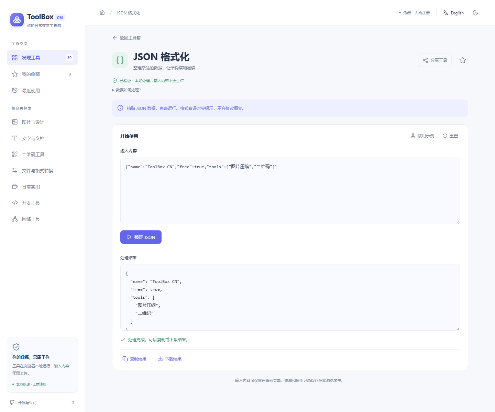

# ToolBox CN

[在线使用](https://cfl071023-bit.github.io/toolbox-cn/) · [GitHub 源码](https://github.com/cfl071023-bit/toolbox-cn) · [构建与部署状态](https://github.com/cfl071023-bit/toolbox-cn/actions)

**让日常小事，更简单。** 面向中文用户的免费在线工具箱：无需注册，默认简体中文，支持英文；55 个工具在浏览器中处理输入。

[English](README.en.md) · [部署指南](docs/DEPLOYMENT.md) · [贡献指南](CONTRIBUTING.md) · [许可证](LICENSE) · [源码分发](SOURCE-CODE.md)


## 从一件想做的小事开始

想把照片变小、给链接做二维码，或清理一份重复名单？在首页点任务入口，或者直接搜索“我想让照片小一点”，再选图片或粘贴内容，完成后复制或下载。

- **不用记住工具名**：常见中文表达与英文请求都可以找任务；暂不支持的 PDF/Word 文件转换会明确说明。
- **试一下就知道怎么用**：示例、对应任务的主按钮、具体错误提示和完成反馈；空结果也有说明。
- **分享工具，不分享输入**：工具链接不带处理内容或地址栏查询参数；隐私说明解释联网加载和本地处理的区别。

当前工作树为 **0.3.0-dev**，源码仓库为 cfl071023-bit/toolbox-cn，网站由本仓库 GitHub Actions 构建并发布到 GitHub Pages。首次部署状态可在上方 Actions 链接查看。历史 QA 记录保留；旧发布 ZIP 仍保留在维护者原工作区，不重复提交到源码仓库。


本轮保留原 30 项、新增 25 项。**PDF 压缩、OCR、图片转矢量 SVG 尚未接入，不计数**。取舍与复用边界见 [上游扩展记录](docs/UPSTREAM-EXPANSION.md)，当前验证见 [扩展 QA 报告](docs/PLATFORM-EXPANSION-QA.zh-CN.md)。历史 0.1.0 发布文档仅描述冻结版本，不代表本开发版本已发布。

## 功能概览

| 分类 | 工具 |
| --- | --- |
| 图片与设计 | 图片压缩、裁剪、等比缩放、JPG/PNG/WebP 互转、颜色转换、SVG 占位图 |
| PDF 与文档 | PDF 合并、PDF 拆分与页面提取 |
| 文字与写作 | 文字对比、字数统计、大小写、去重、Markdown 转 HTML、预览与表格、名单对比、HTML 提取文字与转义 |
| 二维码与分享 | 文字/链接二维码、Wi-Fi 二维码、图片二维码识别 |
| 日常实用 | 时间戳、温度、罗马数字、百分比、单位换算、日期间隔 |
| 数据与格式转换 | 文字/文件 Base64、URL 编解码、JSON↔YAML/CSV/XML/TOML、JSON 展平与还原 |
| 开发工具 | JSON/XML/SQL 格式化、JSON 树与对比、正则测试、CSS/JS 格式化与压缩、UUID、文本 SHA-256、随机字符串、进制转换 |
| 网络工具 | URL 结构分析、IPv4 子网计算、JWT 解码 |
| 隐私与安全 | 文件 SHA-256 指纹核对（不是病毒检测） |

首页提供常用入口、场景推荐、分类、中文同义词/自然语句搜索、收藏和最近使用。支持深浅主题及移动端布局。常用工具为人工精选，没有虚构使用量或排名；所有卡片均连接真实工具。

<p></p>

## 安装与本地开发

需要 Node.js 24（推荐）或 22.x ≥22.12、npm 10+；发布验证使用 Node.js 24。解压源码包，在包含 package.json 的目录运行：

```sh
npm ci
npm run dev
```

打开 [本地开发预览](http://127.0.0.1:5178/)。默认不需要环境变量、API 密钥、数据库或账户。源码获取：git clone https://github.com/cfl071023-bit/toolbox-cn.git，然后 cd toolbox-cn。

```text
src/             应用、工具目录、处理逻辑与保留上游模块
public/          静态资源、许可和生成的对应源码包
scripts/         构建前源码打包、冒烟测试和发布归档
tests/           引擎与浏览器测试、真实图片夹具
docs/            部署、许可核验、截图及工程报告
qa-evidence/     QA 证据；分发副本对本机路径脱敏
upstream/        原始 CorentinTh 基础源码与许可
upstream-sharevb/ 本轮固定版本的 sharevb 扩展源码与许可
```

## 测试与生产构建

```sh
npm test
npx playwright install chromium
npm run test:e2e
npm run build
npm run test:smoke
```

构建结果为 dist/，可作为公开静态网站托管。构建前会生成 source.zip、许可证和第三方声明；部署时应上传整个 dist/。生产浏览器冒烟测试启动临时本地服务，结束后停止；本地手动检查可以运行 `npm run preview`，打开 [生产预览](http://127.0.0.1:5179/)。不要用 file:// 打开 index.html。

原首轮 QA 实测 58 项单元测试、开发/生产各 77 项浏览器检查通过。参见 [完整功能 QA](FUNCTIONAL-QA.zh-CN.md)；本轮测试与限制以 [扩展 QA 报告](docs/PLATFORM-EXPANSION-QA.zh-CN.md) 为准；[0.1.0 发布状态](docs/RELEASE-STATUS.zh-CN.md) 作为历史冻结记录保留。跨浏览器、实体手机和独立安全审计未完成，不能将模拟视口测试理解为所有手机均已验证。

## 隐私与使用边界

55 个工具的当前实现已核验：加载所需资源后可断网处理；测试未发现输入上传或输入/输出持久保存。收藏工具 ID、最近工具 ID、主题和语言保存在 localStorage。没有分析脚本、远程字体或上传接口。首次访问及按需加载工具代码需要网络；托管服务仍会收到常规页面/静态资源请求。外部项目链接只在主动点击时打开。

- 图片输出 JPEG，透明背景变白，压缩结果不保证总是更小。
- JWT 只解码，不验证签名；网络工具不进行远程探测。
- JSON 格式化保留数字原文；JSON/YAML/CSV 互转需保留精度的大整数应写为字符串。
- SHA-256 不是密码存储方案；Wi-Fi 二维码持有者可以读取密码。
- Markdown 输出为源码，在其他网站使用前应按目标网站要求清理。
- 剪贴板、Web Crypto 等能力需要 HTTPS 或 localhost。

## 许可、上游与贡献

本项目作为衍生作品按 **GPL-3.0-only** 分发，保留上游及第三方许可。上游为 [CorentinTh/it-tools](https://github.com/CorentinTh/it-tools)，精确提交为 [`d505845f918e946ec300af7b36efc107e2f66e9e`](https://github.com/CorentinTh/it-tools/tree/d505845f918e946ec300af7b36efc107e2f66e9e)。上游 package.json 的版本字段为 `2024.10.22-7ca5933`；这不是本次采用的提交 ID。

IT-Tools © Corentin Thomasset 与贡献者；ToolBox CN 改动 © 2026 ToolBox CN contributors。本软件不提供担保。请保留 [NOTICE.md](NOTICE.md)、[LICENSE](LICENSE)、[复用记录](REUSE.md) 及第三方声明。正式托管时，界面的“开源与许可”提供同版本完整源码下载；不能只保留压缩后的 JavaScript。

欢迎改进中文用语、无障碍和已确认的功能问题。提交前阅读 [CONTRIBUTING.md](CONTRIBUTING.md)，运行相关测试，并保持原有界面风格和工具本地处理原则。公开仓库尚未创建；创建后再使用其 issue/PR 流程。

本轮扩展固定于 [sharevb/it-tools](https://github.com/sharevb/it-tools) 的 `chore/all-my-stuffs` 分支，提交 `b5eace85dbdb247f832b2aa9967b9d570a84d1ce`。两个上游的完整源码、GPL 及原版权均随对应源码提供；[480 项静态目录清单](docs/UPSTREAM-TOOL-INVENTORY.json) 不代表未接入项已通过测试。

